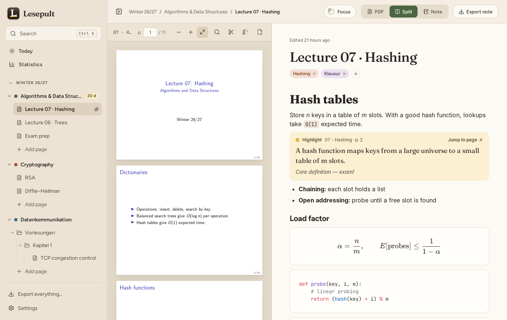
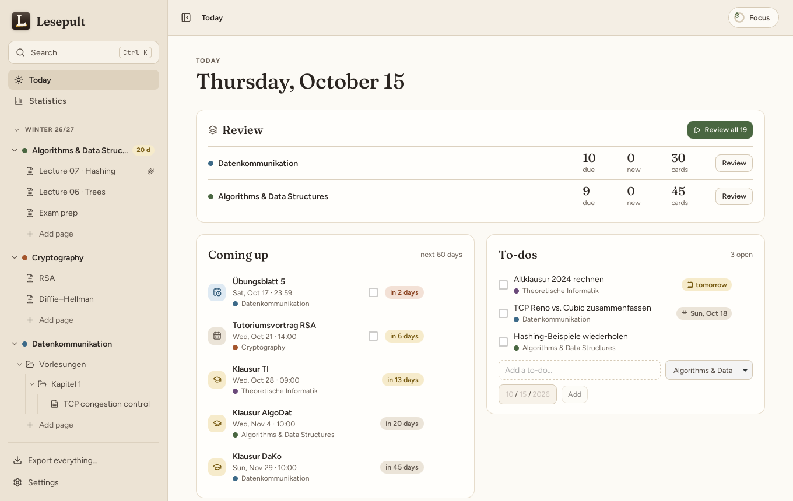
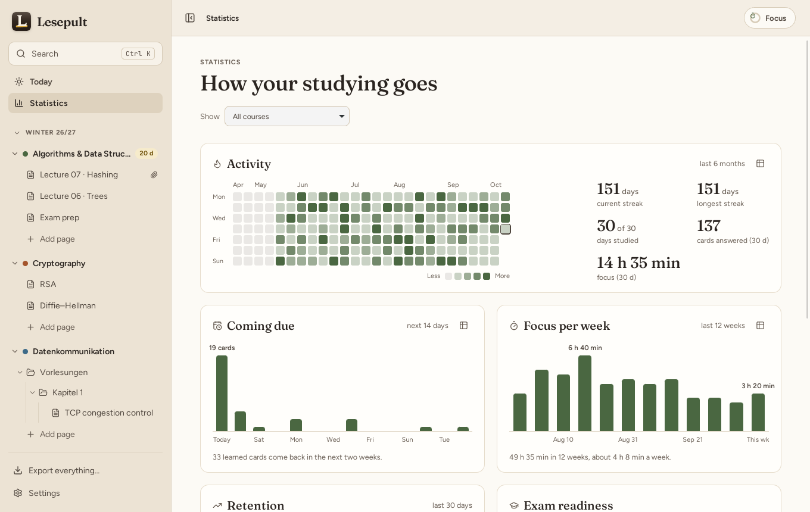
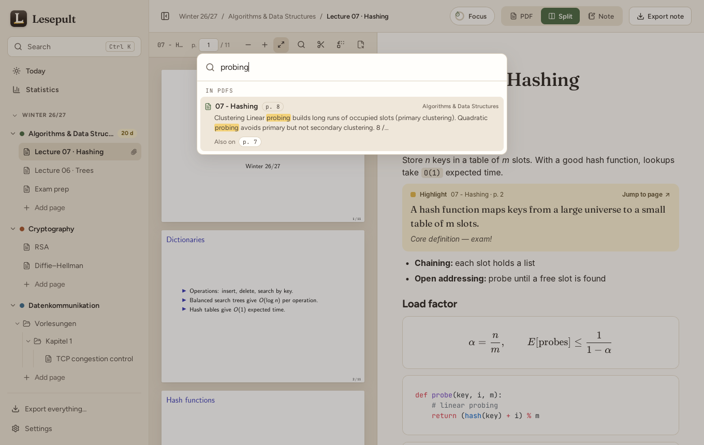
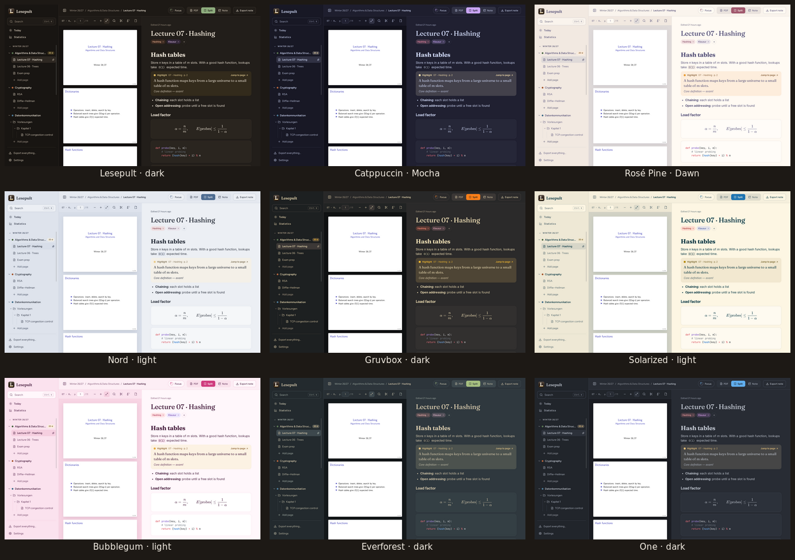

<p align="center">
  
</p>

<h1 align="center">Lesepult</h1>

<p align="center">
  Notes, lecture PDFs and flashcards in one place: a desktop study hub for macOS, Windows and Linux.
</p>

<p align="center">
  <a href="https://github.com/labrikg/lesepult/releases/latest">Download</a> ·
  <a href="docs/GUIDE.md">Guide</a> ·
  <a href="docs/DEVELOPMENT.md">Development</a>
</p>



*Lesepult* is German for lectern, the stand you put your book on while reading. You keep your lecture slides and your
notes side by side, organised by semester, course and folder, and turn what matters into flashcards. Everything stays
on your computer in a single local database; nothing is sent anywhere.

## Features

- **Notes next to the slides.** A block editor (headings, lists, tables, code, LaTeX formulas) beside the PDF.
  Highlight on the slide, send it to the note as a quote that jumps back to the page, or snip a region as an image.
  Text from LaTeX slides keeps its formulas (`$i_1 \cdot i_2 \in \mathbf{N}$`) and its umlauts.
- **Write by hand.** Switch the note to *Pad* and write on lined, grid or dotted sheets next to the slides with a pen
  tablet, a pen laptop (Surface, Windows Ink) or the mouse; on a Mac, an iPad works through Sidecar.
- **Search everything.** ⌘K searches notes and the text of every PDF, finds parts of German compound words
  ("kontrolle" → "Staukontrolle"), and opens the slide with the matches marked. ⌘F finds inside the open PDF (Ctrl+K and Ctrl+F on Windows and Linux).
- **Flashcards with spaced repetition.** Make a card from any highlight or with `/card`; reviews are scheduled with
  FSRS, as in modern Anki. Before an exam, *cram mode* goes through a whole course.
- **Exams, deadlines and to-dos** per course, with a *Today* view of what's due and coming up.
- **Pomodoro timer** that logs focus time per course.
- **Statistics:** an activity heatmap, cards coming due, focus per week, retention per course, and how ready you are
  for each exam.
- **Nine colour themes,** each light and dark: Lesepult, Catppuccin, Rosé Pine, Nord, Gruvbox, Solarized, Bubblegum,
  Everforest and One.
- **Your data, readable anywhere.** Export a note as Markdown or PDF, or the whole library as a folder of Markdown files
  with the PDFs alongside (Obsidian picks up the tags).

The [guide](docs/GUIDE.md) describes every feature and shortcut.

| | |
|---|---|
|  |  |
| **Today** | **Statistics** |
|  |  |
| **Search inside PDFs** | **Themes** |

## Install

Download the latest version from the [releases page](https://github.com/labrikg/lesepult/releases/latest).

**macOS** (Apple Silicon and Intel, macOS 12 or later): open the `.dmg` and drag Lesepult into *Applications*.
Lesepult isn't signed with a paid Apple developer certificate yet, so macOS blocks the first launch:

1. Open Lesepult. When macOS says it can't be verified, click **Done**.
2. Open **System Settings → Privacy & Security**, scroll down to the message about Lesepult, click **Open Anyway** and
   confirm.

After that it opens normally.

**Windows** (10 and 11): run `Lesepult_…_x64-setup.exe`. It installs Lesepult for your user account, without
administrator rights, and adds it to the Start menu. The installer isn't signed with a paid certificate yet, so
Windows SmartScreen may warn that it "protected your PC": click **More info**, then **Run anyway**. Lesepult uses the
Microsoft Edge WebView2 runtime, which Windows 11 has built in; on Windows 10 the installer fetches it if it's missing.

**Linux:** the `.AppImage` runs on most distributions (`chmod +x Lesepult_*.AppImage`, then start it). There are also
`.deb` (Debian, Ubuntu) and `.rpm` (Fedora) packages.

## Build from source

```sh
git clone https://github.com/labrikg/lesepult.git
cd lesepult
npm install
npm run tauri dev
```

You need Node.js 20+ and Rust (on Windows also the Microsoft C++ Build Tools); see [docs/DEVELOPMENT.md](docs/DEVELOPMENT.md) for the system packages, tests and the
project layout.

## Licence

Lesepult is free software under the [GNU General Public License v3.0 or later](LICENSE): you may use, study, share and
change it; versions you distribute must stay under the same licence. The third-party components it includes and their
licences are listed in [THIRD_PARTY_LICENSES.md](THIRD_PARTY_LICENSES.md).

Built with [Tauri](https://tauri.app), [React](https://react.dev), [BlockNote](https://www.blocknotejs.org),
[PDF.js](https://mozilla.github.io/pdf.js/), [KaTeX](https://katex.org), [ts-fsrs](https://github.com/open-spaced-repetition/ts-fsrs)
and SQLite. Theme palettes from [Catppuccin](https://catppuccin.com), [Rosé Pine](https://rosepinetheme.com),
[Nord](https://www.nordtheme.com), [Gruvbox](https://github.com/morhetz/gruvbox),
[Solarized](https://ethanschoonover.com/solarized/), [Everforest](https://github.com/sainnhe/everforest) and
[One](https://github.com/atom/atom/tree/master/packages/one-dark-ui).
